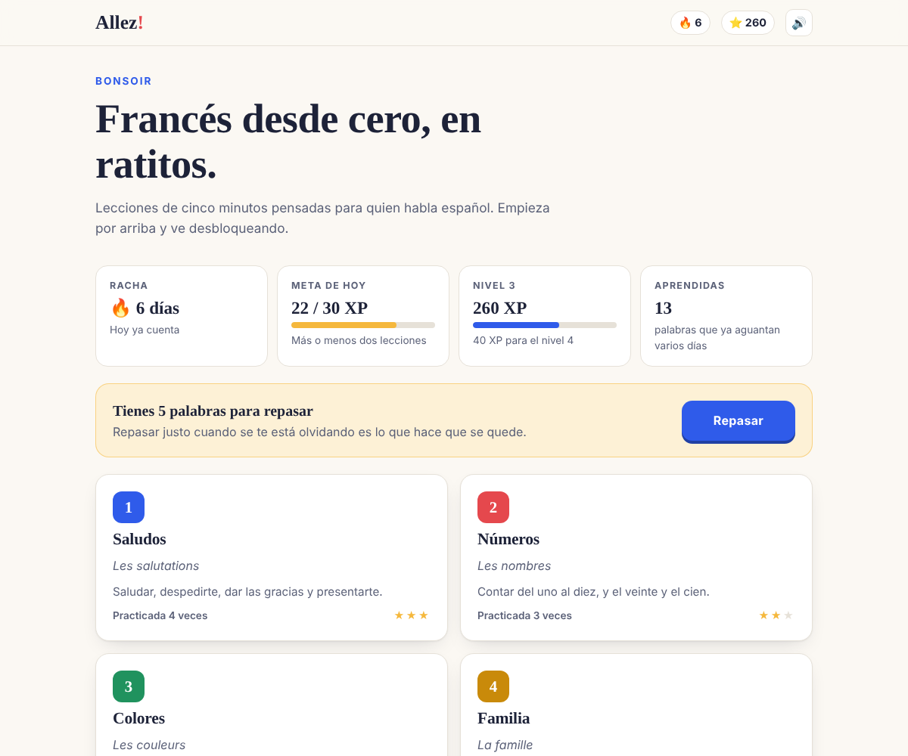
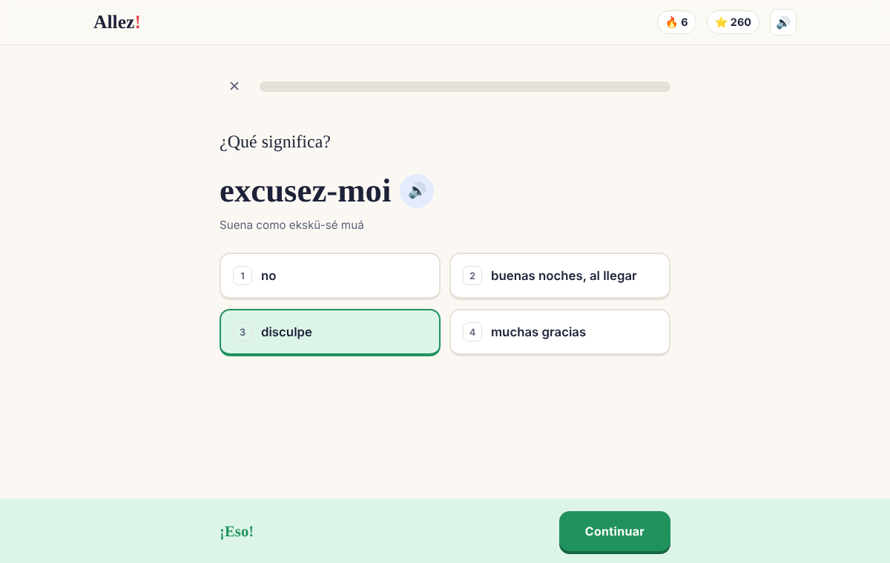
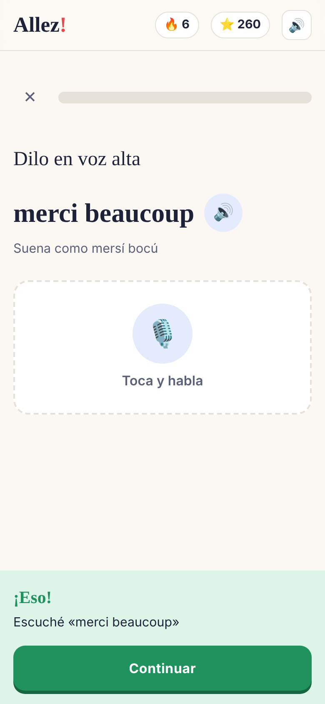

# Allez!

Francés básico desde cero, pensado para quien habla español. Lecciones de cinco minutos, sin cuenta y sin anuncios, directo en el navegador o instalada en el cel.

**Probarla:** https://said1ojeda.github.io/Aprender-Frances/



## Qué trae

- **8 unidades del nivel A1** con 94 palabras y frases: saludos, números, colores, familia, comida, los verbos *être* y *avoir*, frases para viajar y falsos amigos
- **Cinco tipos de ejercicio**: reconocer la palabra, traducir al francés, escribirla, escucharla y decirla en voz alta
- **Voz en francés** con la que trae el navegador, también se puede oír despacio
- **Micrófono** para practicar la pronunciación, la app te dice qué entendió
- **Repaso espaciado** con cajas, como las tarjetas de Anki. Lo que fallas regresa pronto y lo que ya sabes se va espaciando
- **Racha diaria, experiencia y niveles**, con una meta de 30 XP al día
- **Un tip por unidad** con lo que más confunde a un hispanohablante, como que *embarrassée* no es embarazada
- **Se instala como app** y funciona sin internet después de la primera visita
- **Modo oscuro** automático y se puede usar solo con el teclado

| Lección | En el cel |
| --- | --- |
|  |  |

## Cómo funciona

```
index.html         pantallas
css/estilos.css    estilos con modo claro y oscuro
src/tipos.d.ts     tipos de las unidades, ejercicios y progreso
src/datos.ts       las ocho unidades con sus palabras y tips
src/voz.ts         pronunciación y reconocimiento de voz del navegador
src/repaso.ts      repaso espaciado por cajas
src/app.ts         lecciones, revisión de respuestas, racha y experiencia
sw.js              guarda la app para usarla sin internet
js/                lo compilado, no se edita a mano
```

- **Respuestas escritas con criterio.** No importan las mayúsculas ni los signos. Si solo te falta un acento o tienes un error de dedo se cuenta bien, pero te enseña cómo se escribe.
- **La pronunciación se compara con todo lo que entendió el navegador**, no solo con la primera opción, así un acento todavía no muy francés no te castiga de más.
- **Lo que fallas regresa al final de la lección** una vez, y el repaso solo cuenta tu primer intento.
- **Todo el progreso se guarda en tu navegador.** No hay servidor ni cuenta.

La voz y el micrófono dependen del navegador. En Chrome, Edge y Safari funcionan las dos cosas. Si tu navegador no trae voz en francés, esos ejercicios no aparecen.

## Correrla en tu compu

Para usarla, descarga el repo y abre `index.html`. El `js/` ya viene compilado.

Para modificarla necesitas [Node.js](https://nodejs.org):

```
npm install
npm run watch
```

`watch` recompila cada vez que guardas algo de `src/`. Para probar la versión sin internet hay que abrirla con un servidor en `localhost`, por ejemplo `npx serve`.

## Licencia

[MIT](LICENSE)
